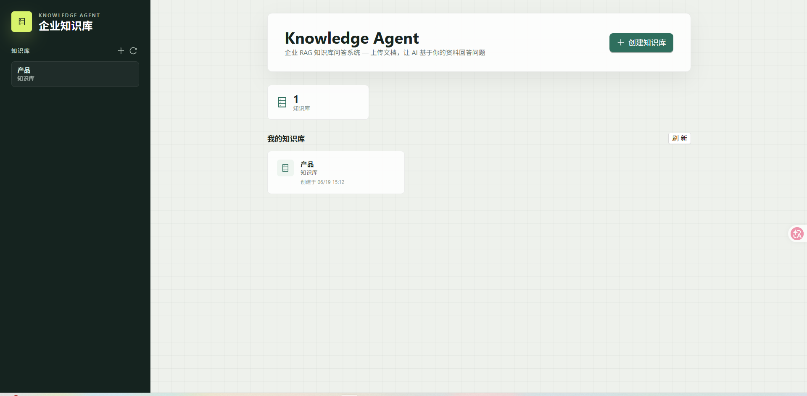
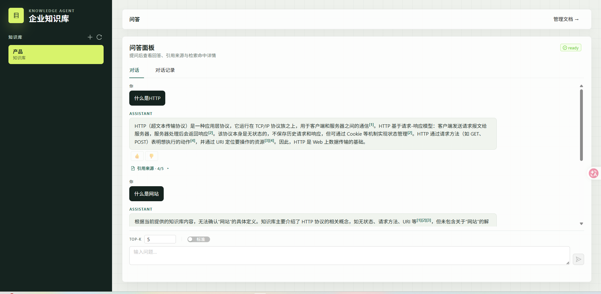
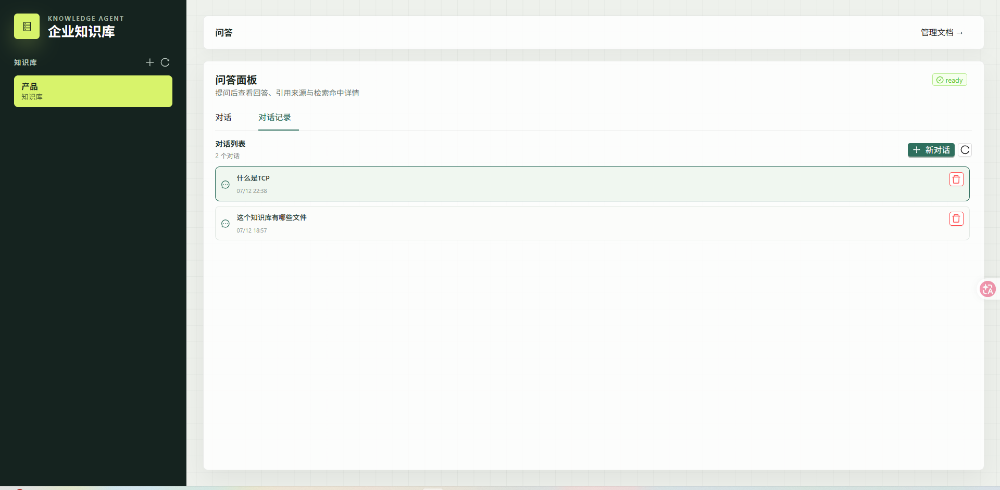
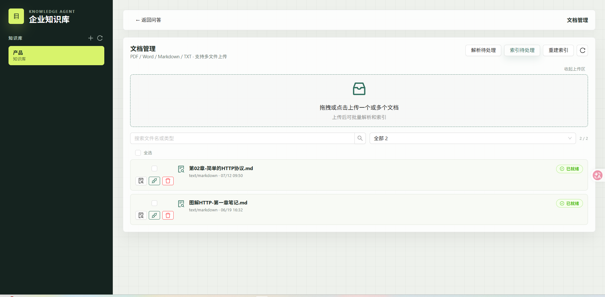
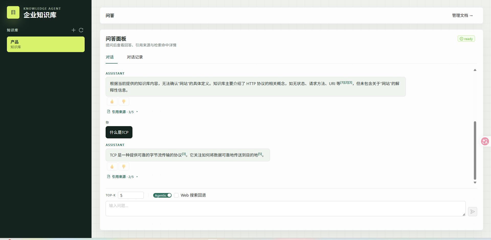

# Knowledge Agent — 项目展示

> 企业 RAG 知识库问答系统 · Vue 3 + FastAPI + LangGraph  
> 统一流式入口自动选择标准 RAG 或 Agentic 自主检索，完整链路可部署

---

## 项目概览

Knowledge Agent 是一个面向企业的智能知识库问答平台。上传文档 → 自动解析索引 → 自然语言提问 → AI 从知识库中检索并回答，支持引用追溯和质量反馈。

**代码量** ~11,300 行 · **测试** 98 单元 + 7 e2e · **技术栈** Vue 3 / FastAPI / ChromaDB / Ollama

---

## 功能亮点

### 知识库管理
- 创建/编辑/删除知识库，侧栏搜索筛选
- 支持 MD、TXT、PDF（表格提取）、DOCX 四种文档格式
- 段落感知语义切块，异步解析索引，服务重启不丢任务

### 混合检索 + Cross-encoder 重排 + 流式问答
- 向量语义检索 + BM25 关键词检索，RRF 融合排序
- 可选 Cross-encoder 重排（本地 / 硅基流动云端），候选 4 倍扩召回再精筛
- SSE 流式逐 token 输出，多轮对话上下文自动传递
- 引用双向联动：点击 `[1]` → 右侧来源卡片高亮
- 来源过滤：只展示 LLM 实际引用的片段

### Agentic RAG（自主检索）
- LLM 分析查询复杂度，复杂问题自动拆子问题
- 每个子问题独立评估与改写（最多 3 轮），整个请求最多 8 次知识库检索
- DuckDuckGo Web 搜索回退
- LangGraph 8 节点上下文准备图，最终答案只流式生成一次
- 可复现 18 题基准：固定语料、三模式对比、确定性指标与 LLM Judge

### 对话管理
- ChatGPT 风格对话列表，多轮对话持久化
- 新建/切换/删除对话，刷新页面自动恢复
- 回答质量反馈（👍👎）

### 工程质量
- API Token 认证 + IP 限流
- BM25 索引持久化 + Embedding 缓存
- 结构化日志 + X-Request-ID 全链路追踪
- 健康检查覆盖数据库 / ChromaDB / LLM
- CI：98 单元测试 + 7 e2e 冒烟测试 + 类型检查
- Docker Compose 一键部署
---

## 系统截图

### 仪表盘首页


### 对话问答


### 对话列表


### 文档管理


### Agentic 检索流程


---

## 系统架构

```
浏览器 (Vue 3 + Ant Design)
    │
    ├─ Nginx / Vite proxy
    │
    ▼
FastAPI 后端
    ├─ SQLite（知识库 / 文档 / 对话 / 任务队列）
    ├─ ChromaDB（向量存储 + HNSW 检索）
    └─ Ollama / OpenAI API（LLM + Embedding）
```

---

## 可复现 RAG 评测

2026-07-29 使用固定的 5 文档语料和 18 道人工标注题，分别运行
Standard、Agentic 和 Auto。主实验禁用 Web 搜索，最终 54 个结果均完成，
LLM Judge 覆盖 54/54。

| 指标 | Standard | Agentic | Auto |
|------|---------:|--------:|-----:|
| 文档召回率 | 0.767 | **0.933** | 0.700 |
| 必要事实覆盖率 | 0.601 | **0.798** | 0.647 |
| Faithfulness | 0.967 | 0.994 | **1.000** |
| Answer correctness | 0.556 | **0.936** | 0.644 |
| 无答案正确率 | 1.000 | 1.000 | 1.000 |
| 平均延迟 | **11.65s** | 65.36s | 48.01s |

Agentic 的检索与答案质量最高，但平均延迟约为 Standard 的 5.6 倍。
Auto 本次将 9/18 题路由到 Agentic，质量与延迟均未达到 Agentic。
实验共发生 17 次瞬时超时，均通过断点恢复补齐。
详见 [`backend/eval/README.md`](backend/eval/README.md) 和评测汇总。

---

## 快速开始

```bash
# 1. 启动全部服务
docker compose up -d

# 2. 打开浏览器
# http://localhost:8080

# 3. 本地开发
cd backend && uvicorn app.main:app --reload --port 8000
cd frontend && npm run dev
```

详见 [DEVELOPMENT.md](DEVELOPMENT.md)
